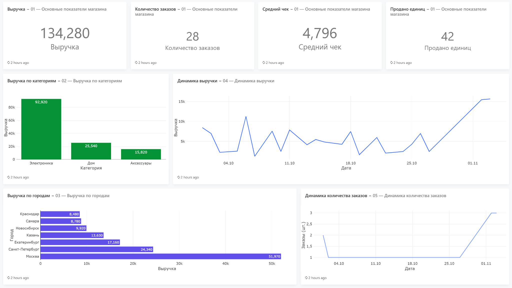

# Shop BI Training

Учебный BI-проект интернет-магазина, демонстрирующий полный цикл работы с данными: от получения информации через REST API до построения аналитического хранилища и визуализации бизнес-показателей.

Проект включает разработку API, Python ETL, обработку данных, PostgreSQL, звёздную схему, аналитические SQL-запросы и Dashboard в Redash.

Все данные синтетические.

## Dashboard



Дашборд разработан в Redash и содержит основные показатели продаж и аналитические визуализации.

### Основные показатели

| Показатель | Значение |
|---|---:|
| Выручка | 134 280 ₽ |
| Количество заказов | 28 |
| Средний чек | 4 796 ₽ |
| Продано единиц | 42 |

*Показатели соответствуют состоянию данных на момент последнего обновления дашборда.*

## Архитектура проекта

```text
                  FastAPI
                     |
                     v
              Python Extract
                     |
                     v
             Data Transformation
              (Pandas, Requests)
                     |
                     v
                  CSV
                     |
                     v
                PostgreSQL
                     |
                     v
                  Staging
                     |
                     v
             Data Quality Checks
                     |
                     v
                  UPSERT
                     |
                     v
               Sales Mart
                     |
                     v
                Star Schema
                     |
              +------+------+
              |             |
              v             v
         SQL Analytics    Redash
                          Dashboard
```

## Технологический стек

| Технология | Назначение |
|---|---|
| Python | Разработка ETL |
| FastAPI | REST API |
| Requests | Получение данных из API |
| Pandas | Обработка и преобразование данных |
| SQLAlchemy | Подключение и работа с БД |
| Psycopg | Драйвер PostgreSQL |
| PostgreSQL | Реляционная БД и аналитическое хранилище |
| SQL | Работа с данными и аналитические запросы |
| Docker Compose | Развёртывание Redash |
| Redash | BI-дашборд и визуализация |
| Git | Контроль версий |

## Структура проекта

```text
shop-bi-training/
│
├── api/
│   └── main.py
│
├── data/
│   └── processed/
│       └── sales_mart.csv
│
├── images/
│   └── dashboard.png
│
├── scripts/
│   ├── extract_all.py
│   ├── extract_orders.py
│   ├── load_sales_mart.py
│   ├── build_star_schema.py
│   └── build_analytics_tables.py
│
├── sql/
│   ├── analytics/
│   │   └── analytical_queries.sql
│   └── ddl/
│       └── create_tables.sql
│
├── test_files/
│   ├── test_db_connection.py
│   └── test_watermark.py
│
├── .gitignore
├── requirements.txt
└── README.md
```

## Источник данных: FastAPI

Разработан собственный REST API, имитирующий работу интернет-магазина.

API предоставляет синтетические данные о:

- Пользователях.
- Товарах.
- Заказах.
- Платежах.

Реализованные возможности:

- Фильтрация по городу, категории товара и статусам.
- Фильтрация заказов по диапазону дат и идентификатору.
- Пагинация с помощью `limit` и `offset`.
- Получение отдельного заказа по `order_id`.
- Автоматическая документация API через Swagger UI.

## ETL

### 1. Извлечение и трансформация данных

Скрипт `extract_all.py` получает данные из FastAPI.

Реализовано:

- Инкрементальное извлечение заказов.
- Использование watermark для определения последней обработанной записи.
- Пагинация при получении заказов.
- Фильтрация заказов со статусом `paid`.
- Получение справочников пользователей и товаров.
- Объединение данных через `Pandas merge()`.
- Расчёт выручки с учётом количества товаров и скидки.

Формула расчёта:

`Revenue = Quantity × Unit Price − Discount`

Результат сохраняется в CSV-файл `data/processed/sales_mart.csv`.

### 2. Загрузка и трансформация данных

Скрипт `load_sales_mart.py` загружает подготовленные данные в PostgreSQL.

Основные этапы:

- Чтение CSV и преобразование типов данных.
- Проверка наличия новых записей по watermark.
- Загрузка данных во временную таблицу `staging_sales_mart`.
- Проверка дубликатов и NULL в обязательных полях.
- Перенос данных в основную таблицу `sales_mart`.
- Обновление записей с помощью `ON CONFLICT DO UPDATE`.
- Обновление watermark.

Основные механизмы:

- Staging Table.
- Data Quality Checks.
- UPSERT.
- Watermark.
- Database Transactions.

### 3. Star Schema — построение аналитического хранилища

Скрипт `build_star_schema.py` формирует звёздную схему на основе `sales_mart`.

**Таблицы измерений:**

| Таблица | Содержание |
|---|---|
| `dim_products` | Товары и категории |
| `dim_users` | Пользователи, города и каналы привлечения |
| `dim_date` | Календарное измерение |

**Таблица фактов:**

`fact_sales` содержит информацию о продажах:

- Заказ и товар.
- Пользователь и дата.
- Количество.
- Цена за единицу.
- Скидка.
- Выручка.

Используется составной первичный ключ `(order_id, product_id)`, позволяющий хранить несколько товарных позиций одного заказа.

Обновление измерений и таблицы фактов выполняется через UPSERT в рамках транзакции.

## SQL Analytics

В проекте подготовлено 15 аналитических SQL-запросов.

Основные направления анализа:

- Общая статистика продаж.
- Анализ товаров и категорий.
- Выручка по городам.
- Эффективность каналов привлечения.
- Анализ среднего чека.
- Динамика продаж.
- Рейтинг товаров.
- Доля выручки.
- Накопительная выручка.
- Анализ клиентской базы и повторных покупок.

Использованные возможности SQL:

- JOIN.
- GROUP BY и HAVING.
- Подзапросы.
- CTE.
- Агрегатные функции.
- Оконные функции.
- UNION.

## BI Dashboard — Redash

Для визуализации результатов используется Redash.

Дашборд включает четыре KPI:

- Общая выручка.
- Количество заказов.
- Средний чек.
- Количество проданных единиц.

Также реализованы четыре графика:

- Выручка по категориям товаров.
- Выручка по городам.
- Динамика выручки.
- Динамика количества заказов.

Redash развёрнут отдельно от основного проекта с помощью Docker Compose и подключён к PostgreSQL.

Живой экземпляр Redash работает локально, поэтому публичная ссылка на интерактивный дашборд не предоставляется. Скриншот результата находится в репозитории.

## Запуск проекта

### Требования

- Python 3.10 или выше.
- PostgreSQL.
- Docker и Docker Compose (для Redash).
- Git.

### 1. Клонирование репозитория

```bash
git clone https://github.com/Sofajk/shop-bi-training.git
cd shop-bi-training
```

### 2. Создание виртуального окружения

```bash
python -m venv .venv
```

Активация в Windows PowerShell:

```powershell
.venv\Scripts\Activate.ps1
```

### 3. Установка зависимостей

```bash
pip install -r requirements.txt
```

### 4. Настройка подключения к PostgreSQL

Создать файл `.env` в корне проекта и указать параметры подключения к базе данных:

```env
DB_USER=your_user
DB_PASSWORD=your_password
DB_HOST=localhost
DB_PORT=5432
DB_NAME=shop_bi
```
Заменить `your_user` и `your_password` на учётные данные PostgreSQL.

### 5. Подготовка базы данных

Создать базу данных `shop_bi`.

Выполнить SQL-скрипт:

```text
sql/ddl/create_tables.sql
```

После создания таблиц необходимо добавить начальную запись в `etl_watermarks` для pipeline `sales_mart`. Это контрольная точка, от которой начинается инкрементальная загрузка.

### 6. Запуск API

Из корня проекта выполнить:

```bash
uvicorn api.main:app --reload
```

Swagger UI:

```text
http://localhost:8000/docs
```

### 7. Запуск ETL

Скрипты выполняются последовательно:

```bash
python scripts/extract_all.py
python scripts/load_sales_mart.py
python scripts/build_star_schema.py
```

### 8. Запуск Redash

Redash развёртывается отдельно с помощью Docker Compose.

После запуска сервисов интерфейс доступен по адресу:

```text
http://localhost:5000
```

Для работы с дашбордом необходимо подключить PostgreSQL, выполнить аналитические SQL-запросы и настроить визуализации.

## Цели проекта

Проект создан для практического освоения и закрепления навыков:

- Разработки REST API.
- Извлечения и обработки данных на Python.
- Построения ETL.
- Инкрементальной загрузки данных.
- Контроля качества данных.
- Проектирования аналитического хранилища.
- Построения звёздной схемы.
- Написания аналитических SQL-запросов.
- Создания BI-дашбордов.

---

**GitHub:** https://github.com/Sofajk/shop-bi-training